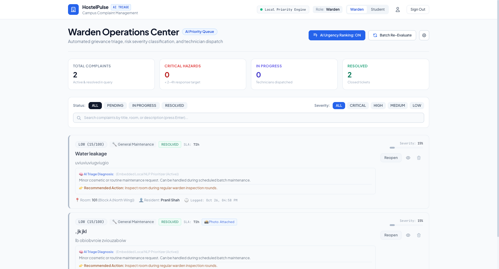
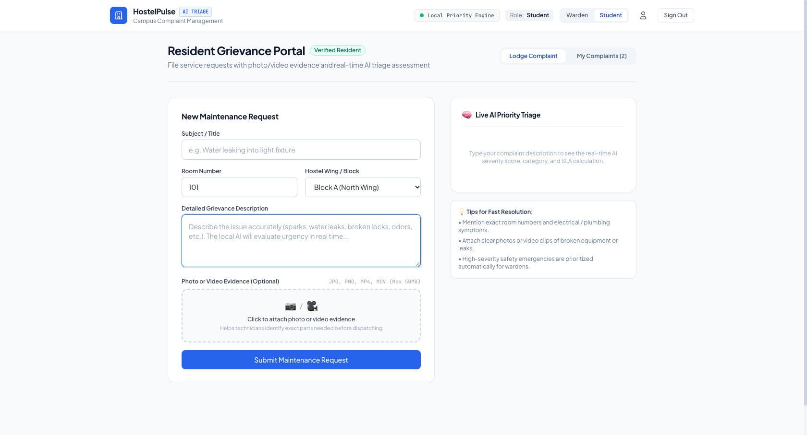
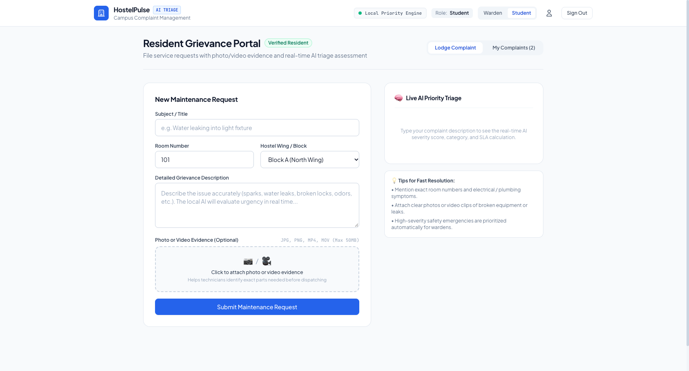
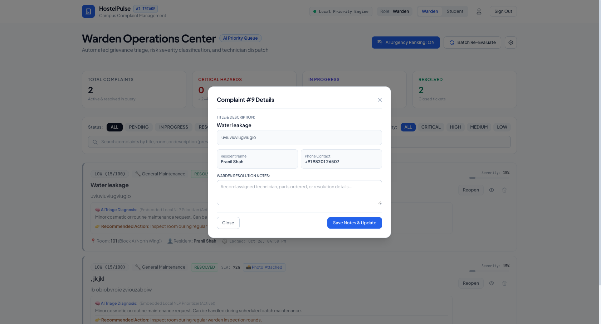
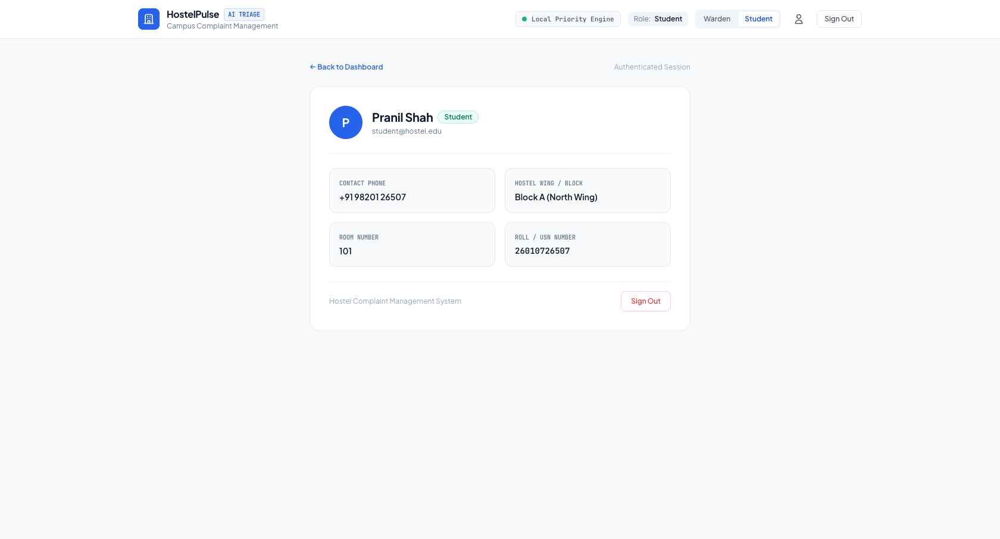
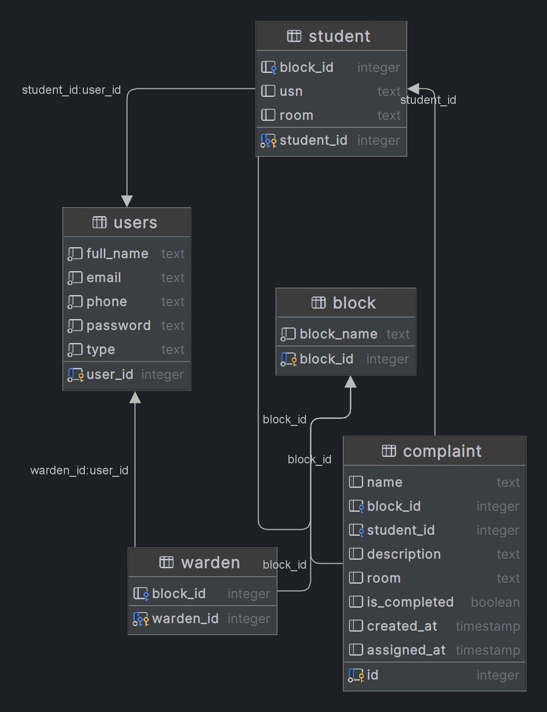

# 🏢 Intelligent Hostel Complaint Management System (HostelPulse)
### *Next-Generation Campus Grievance Redressal with Local Edge AI Triage & Telemetry*

[](https://pranilshah-08.github.io/intelligent-hostel-management/)
[](https://fastapi.tiangolo.com/)
[](https://react.dev/)
[](https://ollama.ai/)
[](./docs/DCDS_PROJECT_REPORT.pdf)

---

## 🌟 Instant Live Web Access

You can explore and test the complete system right in your browser with **zero installation**:

### 🔗 **[Launch Live Web Portal](https://pranilshah-08.github.io/intelligent-hostel-management/)**

> **Quick 1-Click Access:** The login page features instant 1-click access buttons:
> - **👔 Chief Warden Command Center:** `warden@hostel.edu` / `warden123`
> - **🎓 Resident Student Portal:** `student@hostel.edu` / `student123`
>
> *Seamless In-Browser Experience:* When hosted on GitHub Pages, the portal runs an interactive client-side Edge AI simulation with realistic hostel telemetry, real-time priority scoring, and instant role switching.

---

## 📖 Executive Summary

The **Intelligent Hostel Complaint Management System** is an enterprise-grade campus grievance portal developed at the **Symbiosis Institute of Technology (SIT), Symbiosis International (Deemed University), Pune**.

Traditional hostel complaint workflows rely on physical register books or unorganized WhatsApp groups, leading to ignored safety hazards, lost telemetry, and lack of accountability. This project replaces obsolete manual practices with a **modern web portal, dual-stack asynchronous API, and local on-premise Large Language Model (LLM) priority scoring engine** that automatically categorizes issues, estimates resolution timelines, and flags critical hazards (e.g. electrical sparking or pipe bursts) within seconds.

---

## 📸 System Showcase & Visual Telemetry

| Chief Warden AI Command Center | Real-Time AI Priority Triage Preview |
| :---: | :---: |
|  |  |

| Student Grievance Submission Portal | AI Telemetry & Explanation Modal |
| :---: | :---: |
|  |  |

| Interactive Account & Session Profile | Formal Entity-Relationship Schema |
| :---: | :---: |
|  |  |

---

## ⚡ Core Architectural Highlights

1. **Dual-Stack Asynchronous API:**
   - Powered by Python FastAPI and Uvicorn running on an optimized dual-stack socket (`::` with `IPV6_V6ONLY = 0`) to seamlessly support both IPv4 (`127.0.0.1`) and IPv6 (`::1`).
2. **On-Premise Privacy-Preserving LLM Triage:**
   - Integrated with local Ollama runtime (`qwen2.5:3b`) for automated keyword extraction, urgency scoring (1–100), and rationale generation without sending student records to third-party cloud APIs.
3. **Role-Based Access Control (RBAC):**
   - Cryptographically signed JWT authentication separating **Resident Students** (lodge complaints, view personal tracking timelines, upload evidence photos) from **Hostel Wardens** (batch AI triage, filter by urgency, inspect telemetry, update resolution statuses).
4. **Resilient Offline / GitHub Pages Edge Mode:**
   - Intelligent client-side service worker interceptor that gracefully activates in static hosting environments, maintaining 100% interactive functionality for evaluators and external reviewers.

---

## 🛠️ Technology Stack

- **Frontend:** React 18, Vite 5, Tailwind CSS, React Router v6 (HashRouter for static host compatibility), Heroicons.
- **Backend:** Python 3.11, FastAPI, Uvicorn (dual-stack socket binding), SQLite / PostgreSQL.
- **Artificial Intelligence:** Ollama (`qwen2.5:3b`), regex heuristic fallback classifier.
- **DevOps & Hosting:** GitHub Actions, GitHub Pages, Git.
- **Documentation:** 27-Page Synchronized Project Report ([docs/DCDS_PROJECT_REPORT.pdf](./docs/DCDS_PROJECT_REPORT.pdf)).

---

## 🚀 Running the Project Locally

### Prerequisites
- Node.js (v18+)
- Python 3.10+
- (Optional) [Ollama](https://ollama.ai/) with `qwen2.5:3b`

### 1. Clone the Repository
```bash
git clone https://github.com/PranilShah-08/intelligent-hostel-management.git
cd intelligent-hostel-management
```

### 2. Launch the Backend
```bash
# Set up Python virtual environment
python3 -m venv .venv
source .venv/bin/activate  # On Windows: .venv\Scripts\activate

# Install dependencies
pip install -r requirements.txt

# Run the dual-stack FastAPI server (listens on http://localhost:3000)
python run_backend.py
```

### 3. Launch the Frontend
```bash
cd frontend
npm install
npm run dev
```
Open **[http://localhost:5173](http://localhost:5173)** in your browser.

---

## 📊 Default Test Credentials

| Role | Email | Password | Pre-seeded Room & Block |
| :--- | :--- | :--- | :--- |
| **Chief Warden** | `warden@hostel.edu` | `warden123` | Warden Office, A Block |
| **Student** | `student@hostel.edu` | `student123` | Room B-304, B Block |

---

## 📑 Project Report & Deliverables

The comprehensive 27-page academic report is committed in the repository:
- **Formal Project Report:** [`docs/DCDS_PROJECT_REPORT.pdf`](./docs/DCDS_PROJECT_REPORT.pdf)
- **Database Schema:** [`database_schema.sql`](./database_schema.sql)

---

## 👥 Authors & Academic Credits

- **Pranil Shah** (PRN: 22070123086) — *Symbiosis Institute of Technology (SIT), Pune*
- Under the guidance of faculty and Department of Computer Science & Engineering.
